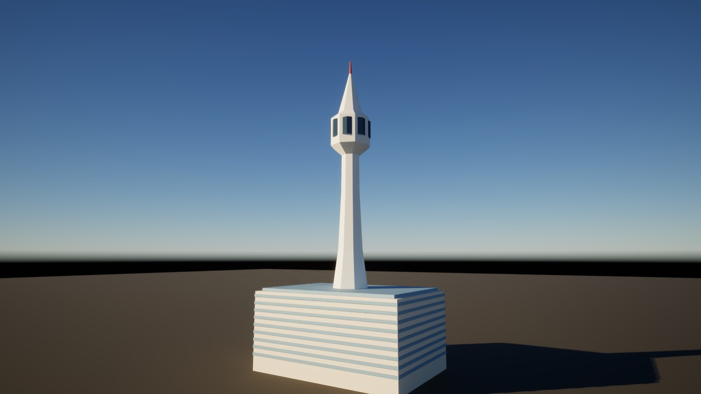

# Kyoto Tower, low-poly

A sample place for [EarthRT](https://github.com/threert/EarthRT): Kyoto Tower and its building as one faceted,
pastel GLB ([assets/models/kyoto-tower.glb](assets/models/kyoto-tower.glb), made from
[scene/lowpoly.ts](scene/lowpoly.ts) by `bun tools/models.ts`). A `glb` place: the map and the traced view (within 600 m) draw the same model.

Topic `site:kyoto-tower`: the other version of
[earth-sample-kyoto-tower](https://github.com/threert/earth-sample-kyoto-tower) (a traced scene module). EarthRT
shows the one ranked first by likes and stars, and lists the other.

CC0. Made from [threert/earth-place-template](https://github.com/threert/earth-place-template).
